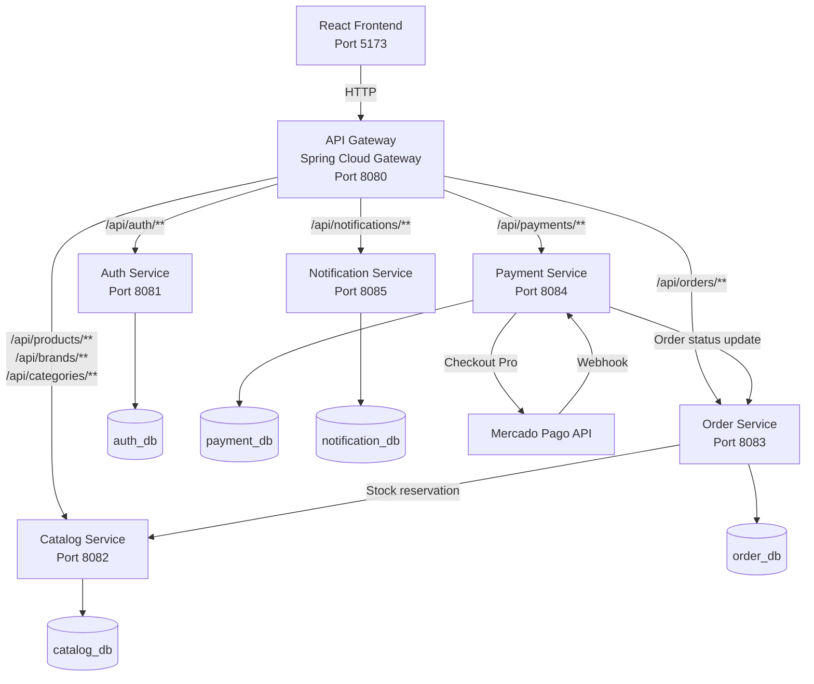
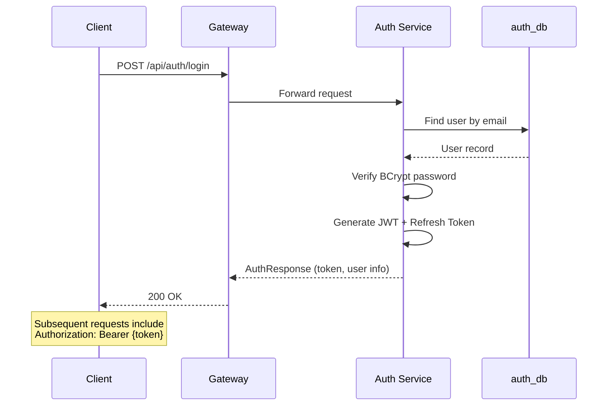
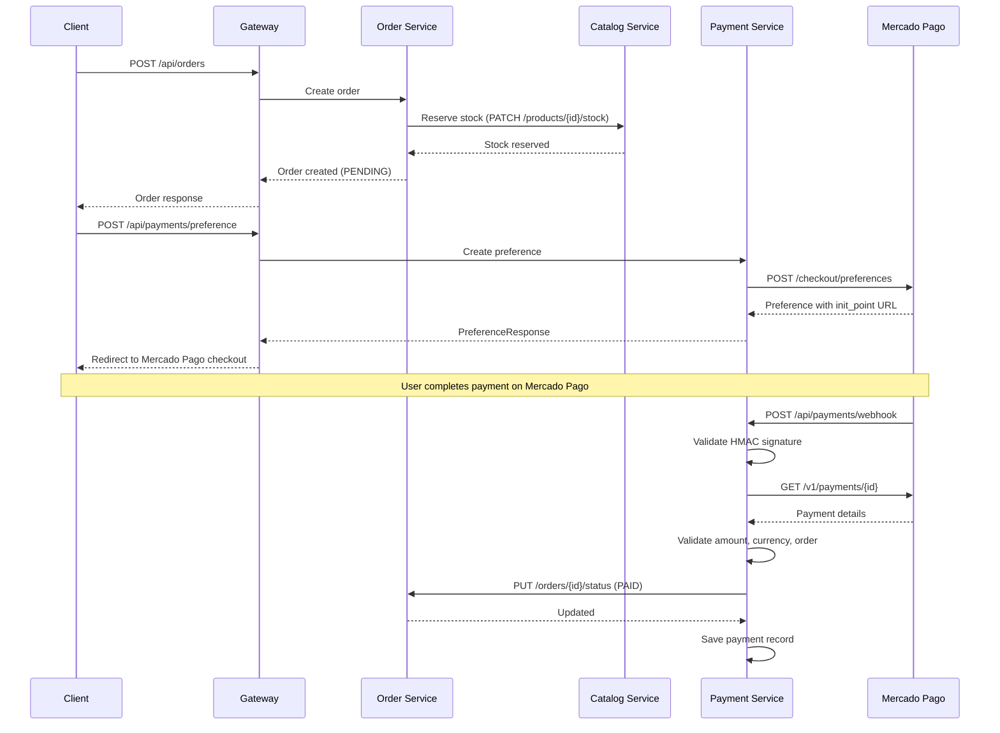

# Architecture Overview

## System Architecture

Cronos Geneve follows a microservices architecture with an API Gateway as the single entry point for all client requests.

## Service Communication

Services communicate via synchronous REST calls. Each service owns its data and exposes an HTTP API.

| From | To | Purpose |
|------|----|---------|
| Frontend | API Gateway | All client requests |
| API Gateway | All services | Route requests |
| Order Service | Catalog Service | Reserve/release stock |
| Payment Service | Order Service | Update order status after payment |
| Payment Service | Mercado Pago | Create preferences, verify payments |
| Mercado Pago | Payment Service | Webhook notifications |

## Request Flows

### Authentication Flow

### Order + Payment Flow

## Technology Choices

| Technology | Choice | Rationale |
|------------|--------|-----------|
| Language | Java 21 | LTS, virtual threads, pattern matching |
| Framework | Spring Boot 3.3 | Mature ecosystem, production-ready |
| Gateway | Spring Cloud Gateway | Native Spring integration, reactive |
| Auth | JWT + Spring Security | Stateless, scalable, industry standard |
| Database | PostgreSQL 16 | Robust, JSON support, mature |
| Migrations | Flyway | Version-controlled schema management |
| Frontend | React + Vite | Fast development, rich ecosystem |
| Styling | Tailwind CSS | Utility-first, rapid UI development |
| Containers | Docker Compose | Reproducible local environments |

## Design Principles

1. **Database per Service** - Each microservice owns its data store, preventing tight coupling.
2. **API Gateway Pattern** - Single entry point simplifies client integration and enables cross-cutting concerns.
3. **Stateless Authentication** - JWT tokens enable horizontal scaling without session affinity.
4. **Synchronous Communication** - REST calls between services for simplicity and debuggability.
5. **Defense in Depth** - Validation at every layer: gateway, service, database constraints.
