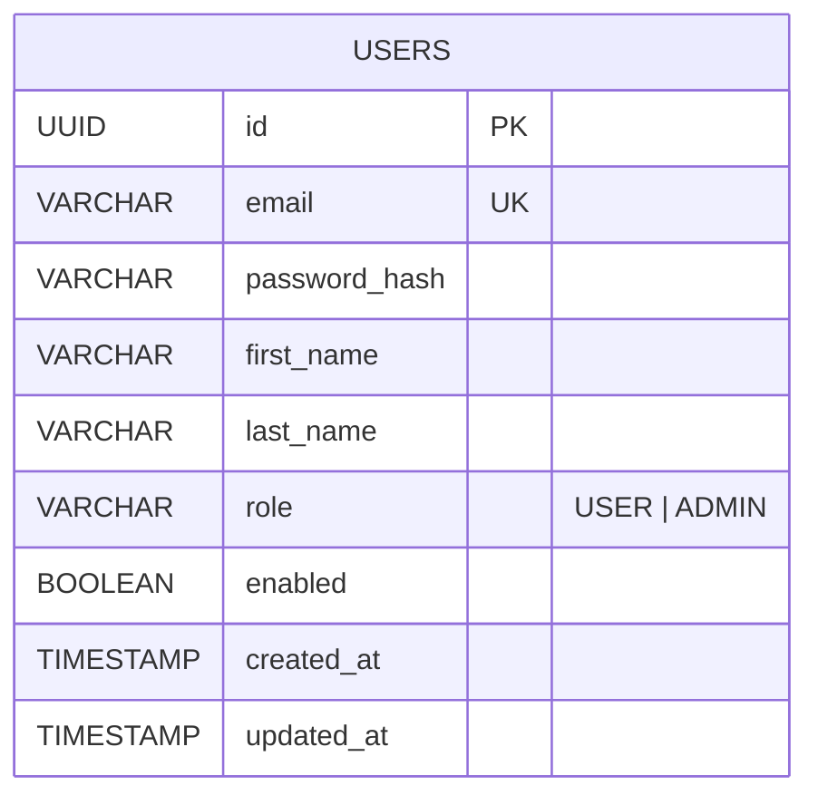
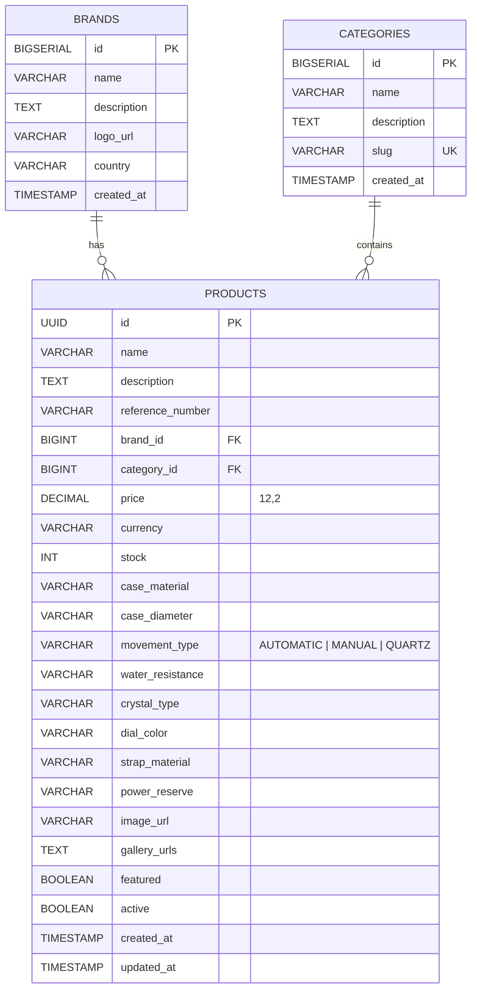
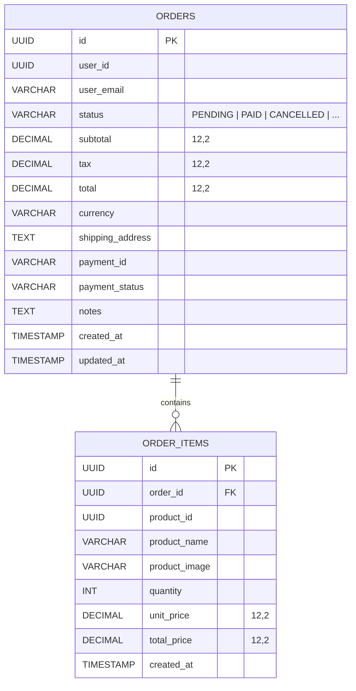
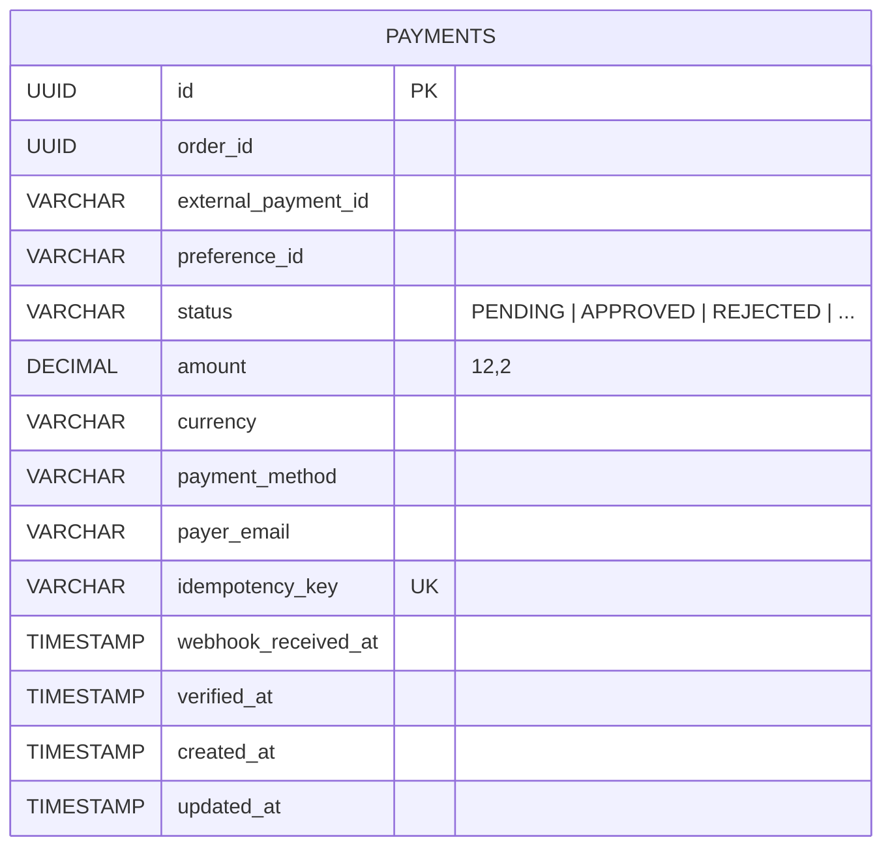
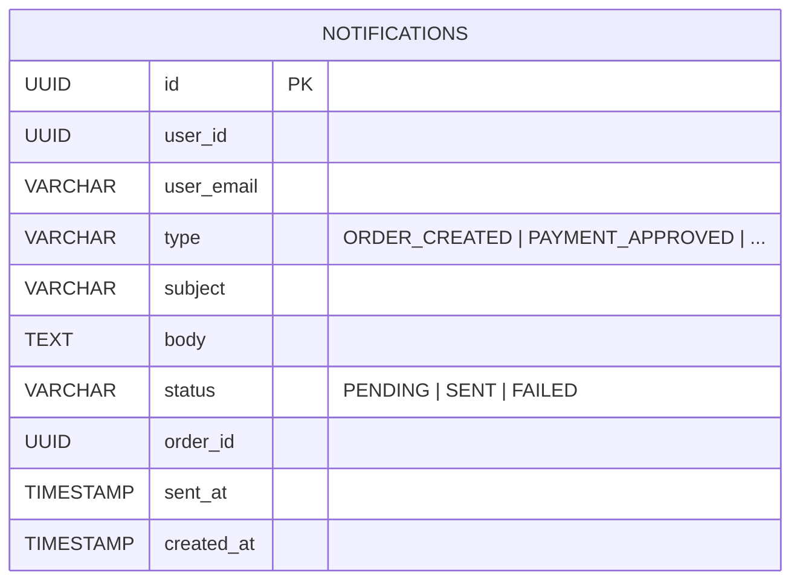

# Database Design

## Strategy: Database per Service

Each microservice owns its database, enforcing strong service boundaries. No service reads or writes another service's tables directly.

| Service | Database | Description |
|---------|----------|-------------|
| Auth Service | auth_db | Users, roles, credentials |
| Catalog Service | catalog_db | Products, brands, categories |
| Order Service | order_db | Orders, order items |
| Payment Service | payment_db | Payments, preferences |
| Notification Service | notification_db | Notification history |

All databases run on a single PostgreSQL 16 instance for development. In production, they can be split into separate instances.

## Schema Migrations

Flyway manages all schema migrations. Each service has its own `db/migration/` directory with versioned SQL files following the pattern `V{version}__{description}.sql`.

Migrations run automatically on service startup.

## Schema Diagrams

### Auth Service (auth_db)



### Catalog Service (catalog_db)



### Order Service (order_db)



### Payment Service (payment_db)



### Notification Service (notification_db)



## Key Design Decisions

1. **UUIDs as primary keys** for orders, products, payments, and users. Prevents enumeration and is safe for distributed systems.
2. **Denormalized product info in order items** (product_name, product_image, unit_price). This ensures order history is accurate even if product details change later.
3. **Idempotency key on payments** prevents duplicate webhook processing.
4. **Indexes** on foreign keys and commonly queried columns (order_id, user_id, external_payment_id).
5. **No cross-database foreign keys** - referential integrity between services is maintained at the application level.

## Database Initialization

The `init-multiple-dbs.sh` script creates all five databases on first PostgreSQL startup. It is mounted into the Docker entrypoint directory.

```bash
# Databases created:
auth_db, catalog_db, order_db, payment_db, notification_db
```

## Connection Configuration

Each service connects to its own database via environment variables:

```yaml
spring:
  datasource:
    url: jdbc:postgresql://${POSTGRES_HOST:localhost}:${POSTGRES_PORT:5432}/${DB_NAME}
    username: ${POSTGRES_USER:cronos}
    password: ${POSTGRES_PASSWORD:cronos_secret_2024}
```
