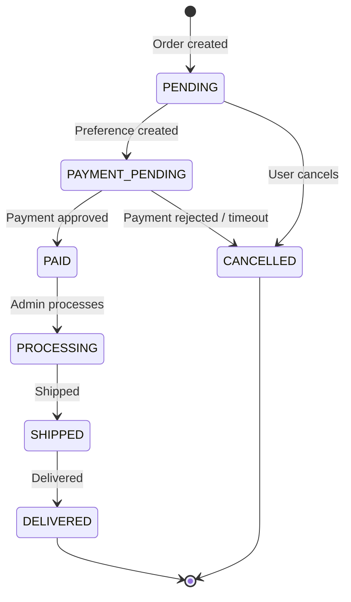

# Microservices Reference

## API Gateway

**Port:** 8080  
**Technology:** Spring Cloud Gateway (reactive)

The gateway is the single entry point for all frontend requests. It routes traffic to backend services, handles CORS, and provides health monitoring.

### Routing Table

| Route Pattern | Target Service | Port |
|---------------|----------------|------|
| `/api/auth/**` | auth-service | 8081 |
| `/api/products/**` | catalog-service | 8082 |
| `/api/brands/**` | catalog-service | 8082 |
| `/api/categories/**` | catalog-service | 8082 |
| `/api/orders/**` | order-service | 8083 |
| `/api/payments/**` | payment-service | 8084 |
| `/api/notifications/**` | notification-service | 8085 |

### CORS Configuration

Allowed origins are configured via the `ALLOWED_ORIGINS` environment variable (comma-separated). Defaults to `http://localhost:5173,http://localhost:3000`.

### Health Check

`GET /actuator/health` returns gateway and downstream service status.

---

## Auth Service

**Port:** 8081  
**Database:** auth_db  
**Responsibilities:** User registration, login, JWT management, role-based authorization

### Key Features

- **Registration** with email uniqueness check and BCrypt password hashing
- **Login** returns JWT access token and refresh token
- **Token refresh** for seamless session extension
- **Role-based access** with USER and ADMIN roles
- **Profile endpoint** for authenticated users
- **Token validation endpoint** for inter-service auth

### Endpoints

| Method | Path | Auth | Description |
|--------|------|------|-------------|
| POST | `/api/auth/register` | No | Register new user |
| POST | `/api/auth/login` | No | Authenticate and receive tokens |
| POST | `/api/auth/refresh` | No | Refresh access token |
| GET | `/api/auth/profile` | Bearer | Get current user profile |
| GET | `/api/auth/validate` | Bearer | Validate token (inter-service) |

### JWT Configuration

| Property | Env Variable | Default |
|----------|-------------|---------|
| Secret key | `JWT_SECRET` | (must be set, min 256 bits) |
| Access token TTL | `JWT_EXPIRATION` | 3600000 ms (1 hour) |
| Refresh token TTL | `JWT_REFRESH_EXPIRATION` | 86400000 ms (24 hours) |

### Demo Users (dev profile only)

| Email | Password | Role |
|-------|----------|------|
| admin@cronos.com | Admin123! | ADMIN |
| user@cronos.com | User123! | USER |

---

## Catalog Service

**Port:** 8082  
**Database:** catalog_db  
**Responsibilities:** Product catalog, brands, categories, stock management, search

### Key Features

- **Product management** with full CRUD operations
- **Brand and category** organization
- **Search** by name with case-insensitive matching
- **Filtering** by brand, category, price range, movement type
- **Pagination** via Spring Data Pageable
- **Featured products** for homepage display
- **Stock management** with atomic reserve/release operations

### Endpoints

| Method | Path | Auth | Description |
|--------|------|------|-------------|
| GET | `/api/products` | No | List products (paginated, filterable) |
| GET | `/api/products/{id}` | No | Get product detail |
| GET | `/api/products/featured` | No | Get featured products |
| GET | `/api/products/search?q=` | No | Search by name |
| POST | `/api/products` | Admin | Create product |
| PUT | `/api/products/{id}` | Admin | Update product |
| PATCH | `/api/products/{id}/stock` | Internal | Reserve/release stock |
| GET | `/api/brands` | No | List all brands |
| GET | `/api/brands/{id}` | No | Get brand detail |
| GET | `/api/categories` | No | List all categories |
| GET | `/api/categories/{id}` | No | Get category detail |

### Query Parameters for Product Listing

| Parameter | Type | Description |
|-----------|------|-------------|
| `page` | int | Page number (0-based) |
| `size` | int | Page size (default 12) |
| `sort` | string | Sort field and direction |
| `brandId` | long | Filter by brand |
| `categoryId` | long | Filter by category |
| `minPrice` | decimal | Minimum price |
| `maxPrice` | decimal | Maximum price |
| `movementType` | string | AUTOMATIC, MANUAL, QUARTZ |
| `q` | string | Search query |

### Seed Data

The catalog ships with 3 brands (Rolex, Omega, TAG Heuer), 4 categories (Sport, Dress, Dive, Chronograph), and 12 luxury watch products with realistic specifications and pricing.

---

## Order Service

**Port:** 8083  
**Database:** order_db  
**Responsibilities:** Order lifecycle, items, totals, stock coordination

### Key Features

- **Order creation** with line item details and total calculation
- **Stock reservation** via Catalog Service on order creation
- **Stock release** on order cancellation
- **Order status management** through defined lifecycle
- **User order history** with filtering

### Order Status Lifecycle



### Endpoints

| Method | Path | Auth | Description |
|--------|------|------|-------------|
| POST | `/api/orders` | Bearer | Create order |
| GET | `/api/orders` | Bearer | List user's orders |
| GET | `/api/orders/{id}` | Bearer | Get order detail |
| PUT | `/api/orders/{id}/status` | Internal | Update order status |
| POST | `/api/orders/{id}/cancel` | Bearer | Cancel order |

### Inter-Service Communication

The Order Service calls the Catalog Service to reserve and release stock:

- **Reserve:** `PATCH /api/products/{id}/stock` with negative quantity adjustment
- **Release:** `PATCH /api/products/{id}/stock` with positive quantity adjustment

If stock reservation fails, the order creation is rolled back.

---

## Payment Service

**Port:** 8084  
**Database:** payment_db  
**Responsibilities:** Mercado Pago integration, payment processing, webhook handling

### Key Features

- **Mercado Pago Checkout Pro** integration
- **Preference creation** with order details and callback URLs
- **Webhook processing** with mandatory HMAC-SHA256 signature validation
- **Payment verification** against Mercado Pago API
- **Idempotency** to prevent duplicate processing
- **Amount and currency validation** before accepting payments

### Endpoints

| Method | Path | Auth | Description |
|--------|------|------|-------------|
| POST | `/api/payments/preference` | Bearer | Create MP preference |
| POST | `/api/payments/webhook` | No (HMAC) | Receive MP webhook |
| GET | `/api/payments/order/{orderId}` | Bearer | Payment status by order |
| GET | `/api/payments/{id}` | Bearer | Payment by ID |

### Webhook Security

All webhooks must include a valid HMAC-SHA256 signature. The service:
1. Extracts `x-signature` and `x-request-id` headers
2. Parses `ts` and `v1` from the signature header
3. Computes HMAC of `id:{data.id};request-id:{x-request-id};ts:{ts};`
4. Rejects the webhook if the computed hash does not match `v1`

See [PAYMENTS.md](PAYMENTS.md) for the full payment flow.

---

## Notification Service

**Port:** 8085  
**Database:** notification_db  
**Responsibilities:** Email notifications, notification history

### Key Features

- **Notification creation** for order and payment events
- **Email delivery** via JavaMailSender (when SMTP is configured)
- **Graceful fallback** - logs notifications when email is not configured
- **Notification history** per user and per order

### Endpoints

| Method | Path | Auth | Description |
|--------|------|------|-------------|
| POST | `/api/notifications` | Internal | Send notification |
| GET | `/api/notifications/user/{userId}` | Bearer | User notifications |
| GET | `/api/notifications/order/{orderId}` | Bearer | Order notifications |

### Notification Types

- `ORDER_CREATED` - New order placed
- `ORDER_CONFIRMED` - Order confirmed
- `PAYMENT_APPROVED` - Payment successful
- `PAYMENT_REJECTED` - Payment failed
- `ORDER_SHIPPED` - Order shipped
- `ORDER_DELIVERED` - Order delivered
- `ORDER_CANCELLED` - Order cancelled

### Email Configuration

Email is optional. When `spring.mail.host` is not set, notifications are logged but not sent via email. To enable email:

```yaml
spring:
  mail:
    host: smtp.gmail.com
    port: 587
    username: your-email@gmail.com
    password: your-app-password
    properties:
      mail.smtp.auth: true
      mail.smtp.starttls.enable: true
```
