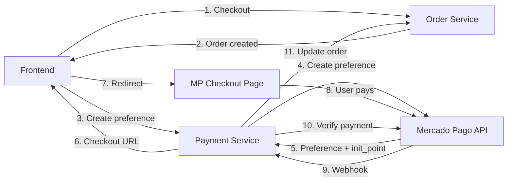
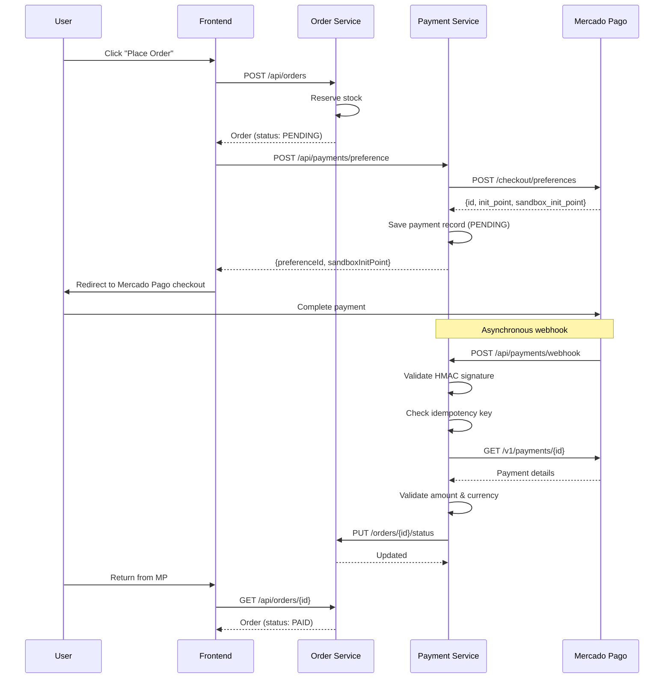

# Mercado Pago Integration

## Overview

Cronos Geneve integrates with Mercado Pago Checkout Pro for payment processing. The integration uses the Sandbox/Test environment for development and demonstration.

## Architecture



## Payment Flow



## Preference Creation

When the frontend requests a payment preference, the Payment Service sends a request to Mercado Pago:

```json
{
  "items": [
    {
      "title": "Rolex Submariner Date",
      "quantity": 1,
      "unit_price": 9950.00,
      "currency_id": "USD"
    }
  ],
  "payer": {
    "email": "user@example.com"
  },
  "back_urls": {
    "success": "http://localhost:5173/order-confirmation/{orderId}",
    "failure": "http://localhost:5173/orders/{orderId}",
    "pending": "http://localhost:5173/orders/{orderId}"
  },
  "external_reference": "{orderId}",
  "auto_return": "approved"
}
```

The response includes `init_point` (production) and `sandbox_init_point` (testing) URLs.

## Webhook Processing

### HMAC Signature Validation

Every webhook must include a valid HMAC-SHA256 signature.

**Headers received:**
```
x-signature: ts=1694000000,v1=abc123def456...
x-request-id: unique-request-id
```

**Validation steps:**
1. Parse `ts` and `v1` from `x-signature`
2. Construct the manifest: `id:{data.id};request-id:{x-request-id};ts:{ts};`
3. Compute HMAC-SHA256 of the manifest using the webhook secret
4. Compare the hex-encoded result with `v1`
5. Reject if any step fails

**No bypasses exist.** There is no test mode, no magic values, no skip condition.

### Idempotency

Each webhook is assigned an idempotency key: `webhook:{externalPaymentId}`. If a payment with this key already exists, the webhook is acknowledged without reprocessing.

### Payment Verification

After signature validation, the service queries Mercado Pago directly:

```
GET https://api.mercadopago.com/v1/payments/{id}
Authorization: Bearer {access_token}
```

The response is validated:
- **Amount** must match the payment record
- **Currency** must match the payment record
- **External reference** must correspond to a valid order
- **Status** determines the outcome (approved, rejected, pending, etc.)

### Status Mapping

| MP Status | Internal Status | Order Status |
|-----------|----------------|-------------|
| approved | APPROVED | PAID |
| rejected | REJECTED | CANCELLED |
| pending | IN_PROCESS | PAYMENT_PENDING |
| in_process | IN_PROCESS | PAYMENT_PENDING |
| cancelled | CANCELLED | CANCELLED |
| refunded | REFUNDED | REFUNDED |

## Configuration

```yaml
mercadopago:
  access-token: ${MERCADOPAGO_ACCESS_TOKEN:}
  webhook-secret: ${MERCADOPAGO_WEBHOOK_SECRET:}
  notification-url: ${MERCADOPAGO_NOTIFICATION_URL:}
```

If `access-token` is empty, the service starts but logs a warning. Preference creation will fail gracefully with an error message.

## Sandbox Testing

### Test Credentials

1. Create a Mercado Pago developer account at https://www.mercadopago.com/developers
2. Create a test application
3. Copy the **Sandbox Access Token** to `MERCADOPAGO_ACCESS_TOKEN`
4. Set up a webhook secret for `MERCADOPAGO_WEBHOOK_SECRET`

### Test Cards

Mercado Pago provides test card numbers:

| Result | Card Number | CVV | Expiry |
|--------|-------------|-----|--------|
| Approved | 5031 7557 3453 0604 | 123 | 11/25 |
| Rejected | 5031 7557 3453 0604 | 456 | 11/25 |
| Pending | Use specific test scenarios | - | - |

### Webhook Testing

For local development, use a tunnel service (ngrok, localtunnel) to expose the webhook endpoint:

```bash
ngrok http 8084
# Set MERCADOPAGO_NOTIFICATION_URL=https://your-tunnel.ngrok.io/api/payments/webhook
```

## Error Handling

| Scenario | Response | Action |
|----------|----------|--------|
| No MP credentials | 503 Service Unavailable | Log warning |
| MP API error | 502 Bad Gateway | Return error to client |
| Invalid webhook signature | 401 Unauthorized | Reject silently |
| Duplicate webhook | 200 OK | Acknowledge without processing |
| Amount mismatch | Payment marked REJECTED | Order notified |
| Payment not found at MP | 404 Not Found | Log error |
